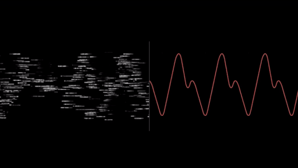
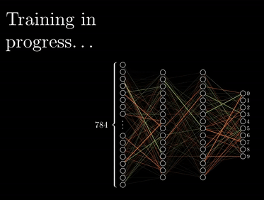
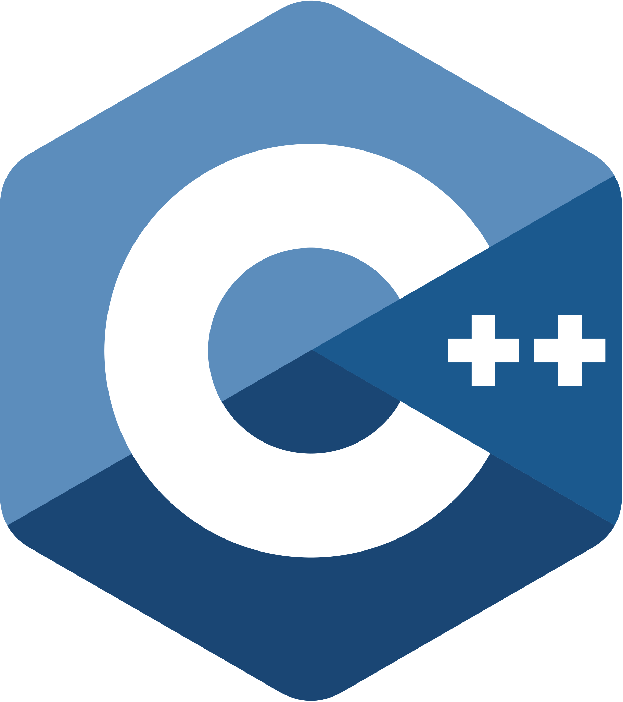

<!--
**tapyu/tapyu** is a ✨ _special_ ✨ repository because its `README.md` (this file) appears on your GitHub profile.

That is what I'm using to make the this Markdown:

*** About wakatime *** (./.github/workflows/waka-readme-stats.yml or the "Waka Readme" github action):
- How To Use Github's New Personal README and Wakatime: https://www.youtube.com/watch?v=jazcHIaitfE
- Adding Weekly Coding Stats to your GitHub Readme Profile: https://www.youtube.com/watch?v=sZi8MmQP3MY

*** About updating README.md with recent activities *** (./.github/workflows/update-readme-recent-activities.yml or the "Update README with recent activities" github action)
- How To Create An Amazing Profile ReadMe With GitHub Actions -> https://www.youtube.com/watch?v=ECuqb5Tv9qI

*** about deploying your own vercel instance (it is the "GitHub Performance" section of my README.dm) ***
1 -> https://github.com/anuraghazra/github-readme-stats#deploy-on-your-own-vercel-instance
2 -> https://www.youtube.com/watch?v=n6d4KHSKqGk&t=107s
3 -> https://github.com/tapyu/github-readme-stats/blob/master/vercel.json
4 -> https://vercel.com/docs/cli#project-configuration
5 -> https://github.com/abhisheknaiidu/awesome-github-profile-readme

*** other things ***
- awesome-github-profile-readme: https://github.com/abhisheknaiidu/awesome-github-profile-readme
- Shelds.io: https://github.com/badges/shields

-->

<p align='center'>
    
</p>

<h1 align="center"><a href="https://linktr.ee/tapyu"><code>>whoami</code></a></h1>
Hi there! I'm Rubem Pacelli (tapyu is just my nickname). I am really into <b>scientific programing languages</b>.
<h1 align="center">Background</h1>
B.Sc. in Electronics Engineering from <a href="https://unifor.br/">Unifor</a>, M.Sc. and PhD in Teleinformatics Engineering from <a href="http://www.ufc.br/">UFC</a>, and PhD in Cotutelle from <a href="https://gage.upc.edu/en">UPC</a>.
<h1 align="center">Research area</h1>
I work in the area of <b>GNSS signal processing</b>, and I especially focus on the following topics:
<table>
  <tr>
    <td width="250">Statistical signal processing, system identification, and adaptive filtering</td>
     <td width="250">Deep learning, pattern recognition, and optimization theory.</td>
     <td width="350">FPGA-based software-defined radio implementation of digital modems</td>
  </tr>
  <tr>
    <td valign="top" align="center"></td>
    <td valign="middle" align="center"></td>
    <td valign="top" align="center"></td>
  </tr>
</table>

<code><a href="https://www.python.org/"></a></code>
<code><a href="https://julialang.org/"></a></code>
<code><a href="https://www.r-project.org/"></a></code>
<code><a href="https://www.mathworks.com/products/matlab.html"></a></code>
<code><a href="https://en.wikipedia.org/wiki/Shell_script"></a></code>
<code><a href="https://en.wikipedia.org/wiki/VHDL"></a></code>
<code><a href="https://en.wikipedia.org/wiki/C_(programming_language)"></a></code>
<code><a href="https://en.wikipedia.org/wiki/C%2B%2B"></a></code>
<br>
<br>
<code><a href="https://code.visualstudio.com/"></a></code>
<code><a href="https://www.linux.org/"></a></code>
<code><a href="https://www.latex-project.org/"></a></code>
<code><a href="https://en.wikipedia.org/wiki/Assembly_language"></a></code>
<code><a href="https://docs.helix-editor.com/"></a></code>
<code><a href="https://git-scm.com/"></a></code>
<code><a href="https://github.com/gnuradio/gnuradio/tree/main"></a></code>
<code><a href="https://github.com/gnss-sdr/gnss-sdr"></a></code>
<br>

---

<h3 align="center">Life is not so serious.</h3>


<details>
    <summary><b>Some nice stats</b></summary>
    <ul> 
    <h3>GitHub Performance</h3>
    <table>
        <tr>
            <td>  </td>
            <td>  </td>
        </tr>
    </table>

### Wakatime stats
<!--START_SECTION:waka-->


**I'm an Early 🐤** 

```text
🌞 Morning                1184 commits        ████░░░░░░░░░░░░░░░░░░░░░   15.39 % 
🌆 Daytime                2907 commits        █████████░░░░░░░░░░░░░░░░   37.78 % 
🌃 Evening                2406 commits        ████████░░░░░░░░░░░░░░░░░   31.27 % 
🌙 Night                  1197 commits        ████░░░░░░░░░░░░░░░░░░░░░   15.56 % 
```
📅 **I'm Most Productive on Thursday** 

```text
Monday                   1289 commits        ████░░░░░░░░░░░░░░░░░░░░░   16.75 % 
Tuesday                  1318 commits        ████░░░░░░░░░░░░░░░░░░░░░   17.13 % 
Wednesday                1323 commits        ████░░░░░░░░░░░░░░░░░░░░░   17.20 % 
Thursday                 1337 commits        ████░░░░░░░░░░░░░░░░░░░░░   17.38 % 
Friday                   1095 commits        ████░░░░░░░░░░░░░░░░░░░░░   14.23 % 
Saturday                 716 commits         ██░░░░░░░░░░░░░░░░░░░░░░░   09.31 % 
Sunday                   616 commits         ██░░░░░░░░░░░░░░░░░░░░░░░   08.01 % 
```


📊 **This Week I Spent My Time On** 

```text
💬 Programming Languages: 
C                        19 hrs 13 mins      ██████████████░░░░░░░░░░░   54.58 % 
Python                   3 hrs 14 mins       ██░░░░░░░░░░░░░░░░░░░░░░░   09.19 % 
Other                    3 hrs 1 min         ██░░░░░░░░░░░░░░░░░░░░░░░   08.56 % 
MATLAB                   2 hrs 54 mins       ██░░░░░░░░░░░░░░░░░░░░░░░   08.26 % 
TeX                      2 hrs 30 mins       ██░░░░░░░░░░░░░░░░░░░░░░░   07.10 % 

🔥 Editors: 
VS Code                  21 hrs 49 mins      ███████████████░░░░░░░░░░   61.94 % 
Claude Code              13 hrs 24 mins      ██████████░░░░░░░░░░░░░░░   38.06 % 

🐱‍💻 Projects: 
gnss-sdr-sim             23 hrs 22 mins      █████████████████░░░░░░░░   66.34 % 
usrp-x310                4 hrs 7 mins        ███░░░░░░░░░░░░░░░░░░░░░░   11.71 % 
main                     1 hr 51 mins        █░░░░░░░░░░░░░░░░░░░░░░░░   05.28 % 
appanalise               1 hr 23 mins        █░░░░░░░░░░░░░░░░░░░░░░░░   03.95 % 
code-anatel-axis4        1 hr 14 mins        █░░░░░░░░░░░░░░░░░░░░░░░░   03.54 % 

💻 Operating System: 
Linux                    35 hrs 14 mins      █████████████████████████   100.00 % 
```

🤖 **AI Coding This Week** 

```text
⏱ AI Coding Time: 19 hrs 14 mins (54.61%)

✍️ 2,484 lines written by AI, 1,285 lines written by hand (65.91% AI-written)

🔤 12,259,159 Input Tokens, 932,892 Output Tokens

💵 $180.89 Estimated AI Cost This Week

🧠 40 AI Sessions, 564 AI Prompts

Opus                     2,504 lines         ████████████████████████░   94.99 % 
Sonnet                   132 lines           █░░░░░░░░░░░░░░░░░░░░░░░░   05.01 % 
Claude-Code              0 lines             ░░░░░░░░░░░░░░░░░░░░░░░░░   00.00 % 

🔎 AI Coding Insights:
⚖️ Balanced with AI — 65.91% of written lines came from AI
📝 Concise Prompter — average 311 characters per prompt
🔁 Iterative Prompter — average 14 prompts per session
🚀 High AI Trust — 47.25% of changed lines were hand-edited
```


 Last Updated on 20/10/2026 21:56:20 UTC
<!--END_SECTION:waka-->

### Recent GitHub Activity
<!--START_SECTION:activity-->
1. 💪 Opened PR [#42](https://github.com/InovaFiscaliza/appAnalise/pull/42) in [InovaFiscaliza/appAnalise](https://github.com/InovaFiscaliza/appAnalise)
2. 💪 Opened PR [#17](https://github.com/InovaFiscaliza/SupportPackages/pull/17) in [InovaFiscaliza/SupportPackages](https://github.com/InovaFiscaliza/SupportPackages)
3. 💪 Opened PR [#16](https://github.com/InovaFiscaliza/SupportPackages/pull/16) in [InovaFiscaliza/SupportPackages](https://github.com/InovaFiscaliza/SupportPackages)
4. ℹ️ Labeled issue [#2049](https://github.com/wimpysworld/deb-get/issues/2049) in [wimpysworld/deb-get](https://github.com/wimpysworld/deb-get)
5. ℹ️ Labeled issue [#2049](https://github.com/wimpysworld/deb-get/issues/2049) in [wimpysworld/deb-get](https://github.com/wimpysworld/deb-get)
<!--END_SECTION:activity-->

### Latest Youtube Video 📺
<!-- YOUTUBE:START -->
- [Mr. Robot - Darlene hacks parking gate with HackRF](https://www.youtube.com/watch?v=y8VQRXDm4hQ)
<!-- YOUTUBE:END -->
</ul>
</details>
